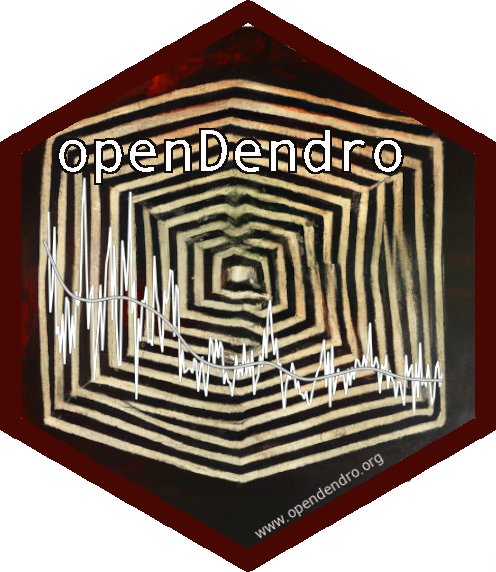

# openDendro

Open-source software for tree-ring science. Crossdate, detrend and build chronologies in R, in Python, or in a web browser, and keep a record that lets anyone repeat the work.

[Try the apps](apps.md){ .md-button .md-button--primary }
[dplR (R users)](r.md){ .md-button }
[dplPy (Python users)](python.md){ .md-button }

## What's Here

  <a class="od-card" href="https://viz.datascience.arizona.edu/xDateR/" target="_blank" rel="noopener">
    App · runs in the browser
    xDateR
    Crossdate a collection. Find the flagged segments, see where a ring is missing or false, fix it, and date floating series.
  </a>
  <a class="od-card" href="https://viz.datascience.arizona.edu/iDetrend/" target="_blank" rel="noopener">
    App · runs in the browser
    iDetrend
    Detrend one series at a time. Watch the curve move as you change it and see what each choice does to the chronology.
  </a>
  <a class="od-card od-purple" href="r/">
    R package · on CRAN
    dplR
    The Dendrochronology Program Library in R. Read, check, crossdate, detrend, build chronologies and analyze them.
  </a>
  <a class="od-card od-purple" href="python/">
    Python package · prerelease on PyPI
    dplPy
    The same methods in Python, on pandas data frames, with its own documentation and worked notebooks.
  </a>
  <a class="od-card od-orange" href="https://opendendro.github.io/learningToLoveDplR/" target="_blank" rel="noopener">
    Book · free online
    Learning to Love dplR
    How to do tree-ring analysis in R, and why each method behaves the way it does.
  </a>
  <a class="od-card od-orange" href="fortran/">
    History
    COFECHA, ARSTAN and the DPL
    The Fortran programs these methods come from, the people who wrote them, and how we use them now.
  </a>

!!! tip "New in October 2026"

    - [xDateR](apps.md#xdater) searches for the lag that fixes a flagged segment, checks your data on the way in, and lets you insert rings, delete rings and fill gaps.
    - [iDetrend](apps.md#idetrend) is rewritten from scratch.
    - Both apps come with guided examples, and both write a report with the R code that reproduces your work.
    - [dplR 1.8.0](r.md#new-in-180) is on CRAN. It is a large release, and two changes can affect old scripts.
    - [dplPy 0.7.0](python.md) is a solid prerelease on the way to 1.0.

## What openDendro Is

Dendrochronology runs on a small set of programs. For decades those were COFECHA, ARSTAN and the rest of the Dendrochronology Program Library, written in Fortran by Richard Holmes and Ed Cook and kept alive by a handful of volunteers.

openDendro is where that toolkit continues in open languages: [dplR](r.md) in R and [dplPy](python.md) in Python, with [apps](apps.md) for the two jobs that are better done by eye, crossdating and detrending. Everything is free, and the source is on [GitHub](https://github.com/opendendro).

Three things matter to us.

Your work can be repeated.
:   A script or a notebook is a record of what you did. The apps keep that record for you, and every report they write carries code that rebuilds the result from the original file.

The choices are yours.
:   Where a careful analyst could go either way, the software gives you an argument with a default we can defend and a help page that says what it trades. When a method cannot be applied to a series, the software stops and names the series.

The old programs are a reference, not a target.
:   We read the original Fortran to learn what a step does and why. We do not tune our code until its numbers match. [More on that](fortran.md).

## Who We Are

openDendro is led by [Andy Bunn](https://github.com/AndyBunn/) (Western Washington University), [Kevin Anchukaitis](http://www.u.arizona.edu/~kanchukaitis/) (University of Arizona), [Tyson Swetnam](https://tyson-swetnam.github.io/) (University of New Mexico) and [Ed Cook](https://people.climate.columbia.edu/users/profile/edward-r-cook) (Lamont-Doherty Earth Observatory), with the Paleoclimate program of the US National Science Foundation behind it. The [About page](about.md) has the developers, the awards and how to cite the software.

Found a bug, or want something the software doesn't do? [Tell us](contribute.md).
