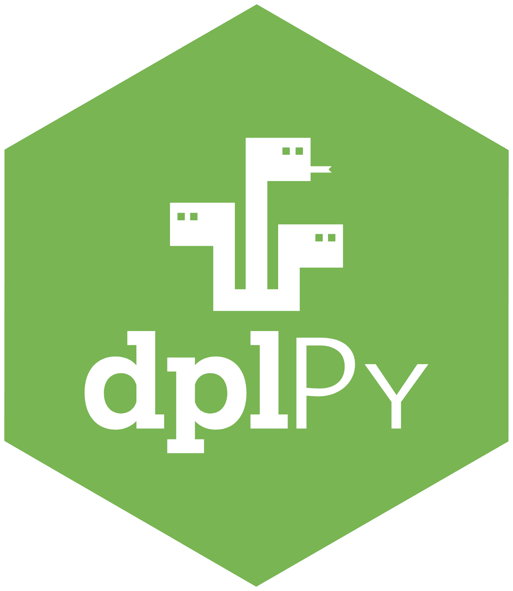

# dplPy

{align="right" width="130"}

dplPy is the Dendrochronology Program Library in Python. It brings the methods of [dplR](r.md) to Python and works on pandas data frames: read and write ring-width files, summarize, detrend, build chronologies, crossdate, date floating series, and do regional curve standardization.

dplPy is in prerelease, at version 0.7.0 and heading for 1.0. It is ready to use, and function names and arguments can still change before 1.0.

[dplPy documentation](https://opendendro.github.io/dplPy/){ .md-button .md-button--primary target=_blank }
[Source on GitHub](https://github.com/OpenDendro/dplPy){ .md-button target=_blank }

## Install

dplPy needs Python 3.10 or later.

```bash
pip install dplpy
```

The [installation guide](https://opendendro.github.io/dplPy/getting-started/installation/){target=_blank} covers setting up Python and an environment if you are starting from nothing.

## A First Chronology

```python
import dplpy as dpl

rwl = dpl.readers("ca533.rwl", header=True)   # ring widths, one column per series
dpl.stats(rwl)                                # summary statistics for each series
rwi = dpl.detrend(rwl, fit="spline")          # ring-width indices
crn = dpl.chron(rwi)                          # the chronology
```

The [quickstart](https://opendendro.github.io/dplPy/getting-started/quickstart/){target=_blank} takes this file from raw ring widths to a crossdated chronology, with the output of every step.

## Learn

- The [dplPy documentation](https://opendendro.github.io/dplPy/){target=_blank} has a guide for each task and a reference for every function.
- [Coming from dplR](https://opendendro.github.io/dplPy/guide/coming-from-dplr/){target=_blank} is for people who already know the R package.
- [Fidelity and departures](https://opendendro.github.io/dplPy/background/fidelity/){target=_blank} says where dplPy matches dplR and the Fortran programs, how that is checked, and where it differs on purpose.
- The notebooks on this site are worked examples you can download and run: an [introduction](notebooks/intro_dplpy.ipynb), a [floating chronology](notebooks/floating_chronology_example.ipynb), a [bristlecone pine collection](notebooks/bristlecone_example.ipynb), and [pulling data from the ITRDB](notebooks/itrdb.ipynb).

## Bugs and Requests

dplPy is young and gets better when people break it. Report a bug or ask for a feature on the [dplPy issue tracker](https://github.com/OpenDendro/dplPy/issues){target=_blank}.
